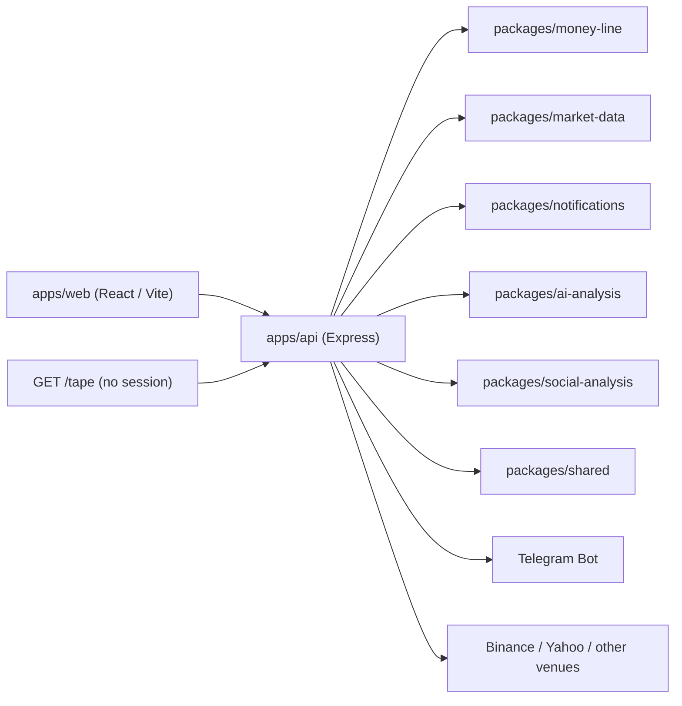

# Money Scanner

Crypto (and cross-asset) market intelligence: a deterministic **Money Line** trend engine, a scanner for confirmed flips and near-flip candidates, alerts, a Telegram bot, and a public Regime Tape.

`package.json` describes the monorepo as “Crypto Market Intelligence, Money Line Engine & Telegram Bot”.

## What it does

Money Scanner scores a universe of assets with a non-repainting Money Line built only on **closed** candles, keeps confirmed flips and “near flip” candidates, and can notify you on Telegram. A signed-in web app (Google via Firebase) shows markets, alerts, research surfaces (AI Briefing, 4x200, Top Alpha, Business Quality), and Crypto Radar. A public, append-only **Regime Tape** at `/tape` is the product’s public ledger of Money Line transitions — including signals that later lost — with 1 / 7 / 30-day outcomes.

The product frame used in the docs: Money Line = *when*, AI Briefing = *where*, 4x200 = *which*.

## Why it exists

To run a repeatable, testable trend process on real market data, with a public record of every regime change, rather than a black-box “the price will go up” feed.

## Features

- **Money Line engine** (`packages/money-line`): a weighted composite of EMA 20/50/200 (alignment and slope), ROC 9/21, MACD 12/26/9, RSI 14, RVOL (MA 20) and ATR 14, plus a Supertrend-style cloud and SMA 50/200 helpers. Flip age comes from the closed candle on which the tier changed, not from scan time.
- **Scanner universe:** 150 coins in CoinGecko market-cap order, with a real candle source (Binance USDT spot or Hyperliquid). Stablecoins are excluded. Automated scans run on 1D and 1W; 4H and 8H stay manual (web Rapid / Complete buttons and Telegram).
- **Alerts and Telegram** (`packages/notifications`): confirmed flips, candidates, price / MA-cross / strategy / SMA-reclaim / structure alerts, delivery guards and idempotency on the closed candle. `/scan radar` sends a deterministic Crypto Radar digest. A Regime Tape Telegram digest is off unless `REGIME_TAPE_TELEGRAM_DIGEST=1`.
- **Market data** (`packages/market-data`): multi-venue prices and candles (Binance, Yahoo, and other adapters), chart-market resolution, and universal search (catalog, Binance, CoinGecko, Yahoo). Metals have no live market cap in the UI.
- **AI surfaces:** Instinct-published daily briefings and per-asset texts (not model-written copy on the page). Deterministic 4x200, Business Quality, and Top Alpha scores. `MODEL_NARRATIVE` is off. A narrative-guard rejects some unsound claims before text is served.
- **Crypto Radar:** scheduled multi-chain research on smaller/newer coins (market, social, wallet safety). Safety sources documented as RugCheck (Solana) and GoPlus (EVM).
- **Public Regime Tape** (`/tape` and `/api/tape/*` before the session middleware): append-only ledger, coverage, daily briefing, Top 5 undervalued. Tone is evidence-based; the page carries method, sources, UTC times, and a risk warning. Nothing auto-posts to X.
- **Access:** Google sign-in through Firebase Auth; the API keeps a session cookie. Mutating requests also need an `X-CSRF-Token`. Access is allowlisted (see `context/acces/CONTEXT.md`). `/api/health` and `/api/chart-market-diagnostics` are public and must not contain secrets.
- **Web UI** (`apps/web`): bilingual Romanian / English, Signal Graphite plus additional signed themes, five primary destinations (Markets, Alerts, Explore, Analysis, More) on desktop rail and mobile dock. Data refresh every 5 minutes; opening a page does not start a scan.
- **Research scripts** under `scripts/` (backtests, forward tests, preflip, four-axes, JEV insight helpers, and similar). These are tools, not the production server.

The production Docker image starts only `apps/api/dist/index.js`. `apps/worker` is built in the monorepo but is **not** the production entrypoint (`CONTEXT.md`, `Dockerfile`).

## Architecture and stack

npm workspaces monorepo. Express REST API (Node 20 in the Docker image), React + Vite web app (served by the API in production), Firebase Auth / Admin, Firestore for persisted state, TypeScript packages, Playwright as a root dev dependency.



Domain maps live in `context/*/CONTEXT.md` and `apps/web/CONTEXT.md`. `HANDOFF.md` is a long chronological journal, not the current contract.

## Project structure

```
apps/api/                 # Express REST API, schedulers, tape page
apps/web/                 # Dashboard (Vite + React)
apps/worker/              # Background worker (not the production Docker CMD)
packages/shared/
packages/money-line/
packages/market-data/
packages/notifications/
packages/ai-analysis/
packages/social-analysis/
scripts/                  # Research, backtests, scheduler helpers
context/                  # Domain CONTEXT files
docs/
insight/                  # Optional host-side JEV insight runner
Dockerfile                # Production: node apps/api/dist/index.js, port 8080
cloudbuild.yaml
.env.example
```

## Installation

```sh
git clone https://github.com/mar1uz/money-scanner.git
cd money-scanner
cp .env.example .env        # fill in locally — never commit secrets
npm install
npm run build
npm test
```

Local development (API and web separately):

```sh
npm run dev:api
npm run dev:web
```

Production-style start after a build:

```sh
npm start                   # node apps/api/dist/index.js
```

The Docker image exposes port **8080**.

## Configuration

Names from `.env.example` only (never commit real values):

| Variable | Purpose |
| --- | --- |
| `NODE_ENV` | Node environment. |
| `PORT` | API port. |
| `GEMINI_API_KEY` | Gemini key (AI Market Analyst package / supporting jobs). Displayed briefings are not generated by the model under the current rules in `context/ai/CONTEXT.md`. |
| `GEMINI_MODEL` | Gemini model id. |
| `BLUESKY_SEARCH_QUERIES` | Comma-separated search terms for free public social ingestion. |
| `TELEGRAM_BOT_TOKEN` | Telegram bot token. |
| `TELEGRAM_WEBHOOK_SECRET` | Telegram webhook secret. |
| `TELEGRAM_SOURCE_CHANNELS` | Allow-list of public channels used as social sources (the bot must be an administrator so Telegram sends `channel_post` updates). |
| `SCAN_INTERVAL_SECONDS` | Scanner interval. |
| `ALERT_COOLDOWN_MINUTES` | Alert cooldown. |
| `DASHBOARD_BASE_URL` | Public base URL of the dashboard (links in messages, etc.). |
| `BINANCE_API_URL` | Binance API base (ingestion fallback). |
| `REGIME_TAPE_TELEGRAM_DIGEST` | Set to `1` to enable the owner-only Telegram digest of new tape events; otherwise leave unset / `0`. |

Firebase / allow-list settings used for login are not in `.env.example`; they are documented in `context/acces/CONTEXT.md` and deployment config. Do not put account lists or tokens in this README.

## Usage

1. Configure `.env`, build, and start the API.
2. Sign in with an allowlisted Google account to use the dashboard.
3. Markets shows the scanner; Alerts is the flip / alert centre (Rapid and Complete scans require a session and CSRF token). “Refresh” only reloads data.
4. Open `/tape` without signing in to read the public ledger.
5. Point a Telegram webhook at the API if you are running the bot.

Scheduled jobs (morning regime scan, tape scan, cache warmer, radar, and others) are configured by scripts under `scripts/configure-*-scheduler.mjs`. Run those only in an environment you control.

## Assets

The repository contains `phone_connect_qr.png` at the root. It is not documented here as a product screenshot.

## Roadmap

Planned or operational follow-ups from the domain docs (not a formal roadmap file):

- Keep Instinct as the only source of published briefing text; do not fall back to model narrative when a briefing is stale.
- Optional host-side JEV insight pipeline (`insight/`, `scripts/jev-insight.mjs`) — runs outside the production image.
- Research and forward tests under `scripts/` and `docs/backtests/` continue separately from the public tape (the tape, not those reports, is the public history).

## License

This project is licensed under the [MIT License](LICENSE).
